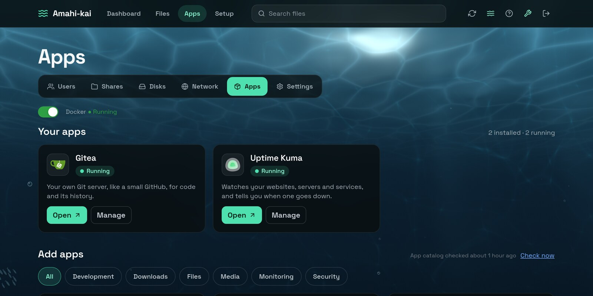

# Amahi-kai

[](https://github.com/CatDogBark/Amahi-kai/actions/workflows/ci.yml)
[](COPYING)
[](https://amahi-kai.com/wiki/getting-started)
[](https://github.com/CatDogBark/Amahi-kai/releases/latest)

A web-based home server for Ubuntu 24.04: users, file shares, storage pooling, Docker apps,
networking and remote access, managed from your browser.



A modernized fork of the [original Amahi platform](https://github.com/amahi/platform), revived for
current Linux.

**Website:** [amahi-kai.com](https://amahi-kai.com), with the guides in its [wiki](https://amahi-kai.com/wiki/).

## Install

On a dedicated Ubuntu 24.04 machine or VM:

```bash
curl -fsSL https://amahi-kai.com/install.sh | sudo bash
```

Or from a checkout:

```bash
git clone https://github.com/CatDogBark/Amahi-kai.git
cd Amahi-kai
sudo bin/amahi-install
```

Then open `http://<your-server-ip>:3000`. The setup wizard runs on first login: admin password,
network, drives, storage pool and a first share. More in [docs/NATIVE-INSTALL.md](docs/NATIVE-INSTALL.md).

- **Updates:** Amahi-kai checks every 6 hours; Settings → System Status shows what's new, with
  Update now (or Repair). A failed update rolls back.
- **Backups:** Amahi-kai doesn't back the server up yet: its own settings, and shares on the
  system disk, need copies of your own ([what to keep](https://amahi-kai.com/wiki/getting-started#what-amahi-kai-doesnt-back-up)).
- **Logs:** `journalctl -u amahi-kai -f`
- **Config:** `/etc/amahi-kai/amahi.env`

## Features

- **File sharing:** Samba shares with per-user access, a Trash, a web file browser and search
- **Storage:** Greyhole pooling across plain drives, or ZFS pools (mirrors and RAIDZ) with hourly
  and daily snapshots, roll-back, scrubs and drive health
- **Docker apps:** one-click installs from a catalog of its own, [amahi-kai-apps](https://github.com/CatDogBark/amahi-kai-apps)
  (Jellyfin, PiGallery2, Vaultwarden, Gitea, Uptime Kuma, Transmission, bitTube, and bitShare,
  which is early), with updates that copy the app's data first and roll back by themselves;
  [make your own](https://amahi-kai.com/wiki/making-apps). Vaultwarden, which needs HTTPS, is
  reached only through Tailscale, over HTTPS with Tailscale's certificate.
- **Networking:** the NAS as your network's DNS server (encrypted lookups, DNSSEC, ad and
  tracker blocking), its DHCP server, and if you like its router, with nothing from the internet
  let in but the ports you choose; the NAS's own address set from the page
- **Remote access:** Cloudflare Tunnel (no port forwarding) and Tailscale
- **Dashboard:** CPU, memory, the system disk, each storage pool's space and health, and services;
  Settings → Servers for each service's version, uptime and controls
- **Security audit:** checks SSH, the firewall and updates, with fixes
- **Ocean UI:** animated underwater background behind dark glass panels

## Security

- Root actions go through one root helper (`libexec/amahi-helper`) that validates every request
  and logs it; sudo allows only the helper. Root owns the installed code.
- bcrypt passwords; sign-ins that end with the browser, or after 7 idle days with Remember me,
  and 30 days after they're made either way; signing out, or a password change, signs out the
  other browsers
- CSRF protection, with system actions on POST only; sign-in limits; a host allowlist
- Secrets stay off command lines and out of logs
- Details: [docs/security/PRIVILEGE-ESCALATION-MITIGATION.md](docs/security/PRIVILEGE-ESCALATION-MITIGATION.md)

## Development

Ruby 3.2, Rails 8.1, Bootstrap 5.3 with Stimulus and plain JavaScript, MariaDB in production and
SQLite for tests.

```bash
bundle install
RAILS_ENV=test bundle exec rails db:schema:load
bundle exec rspec spec/models/ spec/services/ spec/helpers/
bundle exec rspec spec/lib/
bundle exec rspec spec/requests/
```

See [CONTRIBUTING.md](CONTRIBUTING.md) for how changes are made and released, and
[docs/plans/roadmap.md](docs/plans/roadmap.md) for what's done and what's next.

| Folder | What's there |
| --- | --- |
| `app/` | Controllers, models, views, helpers, services, assets |
| `lib/` | System integration: disks, Samba, Greyhole, Docker, tunnel, services, update status |
| `libexec/amahi-helper`, `libexec/amahi-helper.d/` | The root helper and its parts, one per area (installed as one file) |
| `bin/` | `amahi-install`, `amahi-update` and the scripts they run |
| `config/` | Rails config, the app catalog's built-in copy, sudoers rules, systemd units |
| `docs/` | Install guide, security model, plans |
| `site/` | The amahi-kai.com website and wiki |

## Credits

- **Original:** [Amahi](http://www.amahi.org) (2007-2013)
- **Modernization:** CatDogBark (2026) + Claude

Questions, problems, ideas: [GitHub Issues](https://github.com/CatDogBark/Amahi-kai/issues), or email
catdogbark@pm.me.

## License

GNU AGPL v3. See [COPYING](COPYING) and [NOTICE.md](NOTICE.md).
